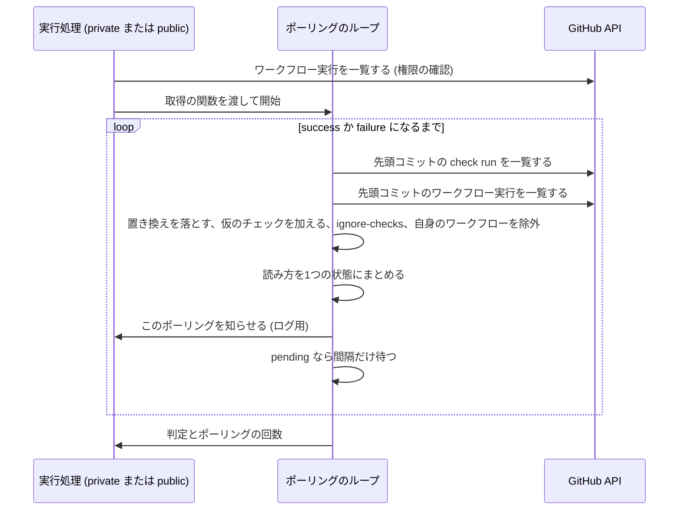

# チェックの集約の設計

[English](design.md)

## このドキュメントについて

この文書は、ゲートが[チェックの集約](requirements.ja.md)をどう満たすかを説明します。ポーリングのたびに GitHub から何を読むか、それを評価するチェックへどう絞るか、ポーリングのループがどう終わるか、を扱います。
親の Product は [automerge-gate](../../product.ja.md) です。

### 対象読者

ゲートが読むもの、除外するもの、ポーリングの方法を変更する人とエージェント。

### 前提知識

GitHub の Checks API とその用語。check run は、コミットに付く1つの結果である。check suite は、1つの GitHub App が1つのコミットに対して作った check run をまとめたものである。GitHub Actions のワークフロー実行は、それぞれ自分の check suite を持つ。

### このドキュメントで扱わないこと

ポーリングをいつ始め、判定がどこへ行くかは、[ゲートモード](../gate-modes/requirements.ja.md)で扱う。
`ignore-checks` と置き換えられた実行の決まりは別の機能であり、その Requirements はまだ書かれていない。この文書は、それらを処理の流れのどこに置くかだけを述べる。

## 実装方針

集約は、先頭コミットについて評価するチェックを返す1つの関数を、ループで囲んだものである。
どちらのゲートモードも、その関数を同じように組み立て、同じループに渡す。
ループは評価するチェックを求め、それらを1つの状態にまとめ、状態が `success` か `failure` になったら止まる。

各部分は、できるだけ純粋に保っている。
1つのチェックの読み取り、読み方のまとめ、どの実行が置き換えられたかの判断、`ignore-checks` のルールの一致は、データを受け取ってデータを返す。
API とジョブのログに触れるのは、取得の関数と2つの実行処理だけである。これにより、単体テストはネットワークなしで決まりを確かめられる。

### 1回のポーリング

1回のポーリングは、次の段階をこの順に行う。

1. **check run を読む。** ページをたどる1つの要求で、先頭コミットの check run を一覧する。GitHub には、それぞれの最新の試行を求める。結果ごとに、名前、status、conclusion、リンク、GitHub App の slug、check suite の id を保持する。
2. **ワークフロー実行を読む。** ページをたどる1つの要求で、先頭コミットのワークフロー実行を、ワークフローファイル、イベント、status、check suite とともに一覧する。
3. **置き換えられた結果を落とす。** ワークフロー実行を、ワークフローファイルとイベントでグループにする。各グループで、最も新しい実行以外はすべて置き換えられたものである。置き換えられた実行の check run は、置き換えられた実行の決まりに従って落とす。
4. **ジョブのない実行を加える。** 完了しておらず、置き換えられておらず、check run がまだなく、ゲート自身のワークフローファイルの実行でもないワークフロー実行それぞれについて、status が `queued` の仮のチェックを1つ加える。仮のチェックは、ワークフローの名前、実行へのリンク、ワークフローファイルを持つ。
5. **ワークフローファイルを調べる。** `ignore-checks` のルールが `workflow` を使うときだけ、GitHub Actions の各 check run に、その実行のワークフローファイルを付ける。
6. **`ignore-checks` を適用する。**
7. **ゲート自身のワークフローを除外する。**

段階3の前の件数が `total-checks` 出力である。段階7のあとの一覧が、ループが評価するものであり、`evaluated-checks` と `completed-checks` が数えるものである。

### 仮のチェックがある理由

GitHub は、ワークフロー実行をキューに入れた時点でその実行を作るが、その実行のジョブが check run になるのは数秒あとである。
その隙間でポーリングしたゲートは、すでにある check run がすべて合格しているのを見て、新しい実行のジョブが現れる前に success を報告してしまう。
この場合は、[E2E テストケース](../../../../e2e-test-cases.md)の TC-cancel-7 である。より新しい実行が、キャンセル済みの実行を置き換える場面で起きる。
仮のチェックは、キューにある実行を、実際の check run ができるまで未完了のチェックとして見えるようにする。

### ゲート自身のワークフローの除外

ゲートのジョブは、それ自体が先頭コミットの check run であり、ゲートがポーリングしている間は `in_progress` のままである。これを評価すると、いつまでも終わらない。
また、同じコミットでの以前のゲートの実行は、多くの場合ワークフローの concurrency の設定でキャンセルされており、評価すると不合格として読まれる。

そのためゲートは、ワークフローファイルがゲート自身のものである GitHub Actions の check run をすべて取り除く。
ゲートは、自分のワークフローファイルを環境変数 `GITHUB_WORKFLOW_REF` から知る。check run のワークフローファイルは、check run のリンクから実行の id を取り出し、Actions の API にその実行を問い合わせて知る。
問い合わせの結果は、ゲートの実行の間、実行の id ごとにキャッシュする。問い合わせに失敗したときは「ゲートのワークフローではない」として扱う。
`GITHUB_WORKFLOW_REF` がないときは、何も除外しない。

現在の実行の id だけでなくワークフローファイルを比べることで、キャンセルされた以前の実行も対象になる。

### ループ

ループには、それ自身のタイムアウトも、再試行の上限もない。
例外を投げたポーリングは、失敗したポーリングとして扱う。実行処理がすでに警告をログに出しており、ループは間隔だけ待って、もう一度試す。
判定に達しないループは、ジョブの `timeout-minutes` が終わらせる。

ループに入る前に、それぞれの実行処理は、ワークフロー実行の要求を1回行う。
GitHub がクライアントエラーを返したとき、実行処理は `actions: read` についてのメッセージでジョブを失敗させる。
この確認がないと、権限の不足は失敗したポーリングとして、ジョブがタイムアウトするまで再試行されてしまう。

### ポーリングにタイムアウトの入力がない理由

GitHub Actions は、ジョブの `timeout-minutes` を読む手段をアクションに与えていない。そのためアクション側のタイムアウトは、利用者がジョブのタイムアウトより小さく保つ必要のある2つ目の値になる。
また、タイムアウト時に確実に `failure` を書くには、ジョブが強制終了されたあとに動くステップが必要だが、GitHub はタイムアウトで強制終了したジョブの post ステップを実行しない。
そのためゲートは、上限をジョブに任せ、ジョブが強制終了されたときは何も報告しない。

## アーキテクチャ・シーケンス図

## データモデル・ER 図

実行の中では、すべてのチェックを1つの形で持つ。id、名前、status、ないこともある conclusion、リンク、App の slug、check suite の id、そして任意でワークフローファイルである。
ワークフローファイルには3つの状態がある。まだ調べていない、調べたが当てはまらない（ほかの App のチェック）、パス、である。
仮のチェックは、実際の check run と重ならないように、ワークフロー実行の id を負にしたものを id に使う。

使う関係は、check run → check suite → ワークフロー実行だけなので、図は不要である。

## API・インターフェース

### 入力

| 入力 | 役割 |
| --- | --- |
| `poll-interval-seconds` | ポーリングの間の秒数。既定は `30`。正の整数として読めなければならない。 |
| `ignore-checks` | 段階6で適用するルール。既定は `[]`。 |
| `token` | API に使うトークン。 |

### 出力

`state`、`total-checks`、`evaluated-checks`、`completed-checks`、`polled-iterations`。意味は Requirements のとおり。ループが返ったあとに、実行処理が設定する。

### 内部のインターフェース

ループは、評価するチェックを返す関数と間隔を受け取り、判定とポーリングの回数を返す。
また、各ポーリングのあとに、ポーリングの番号、状態、件数を知らせる。結果のログがこれを使う。

## 外部サービスとの連携方式

| 目的 | エンドポイント |
| --- | --- |
| 先頭コミットの check run | `GET /repos/{owner}/{repo}/commits/{ref}/check-runs` に `filter=latest` を付ける（[Check runs](https://docs.github.com/en/rest/checks/runs)） |
| 先頭コミットのワークフロー実行 | `GET /repos/{owner}/{repo}/actions/runs?head_sha=...` |
| 1つの実行のワークフローファイル | `GET /repos/{owner}/{repo}/actions/runs/{run_id}` |

一覧は1ページ100件で求め、最後までたどる。
それぞれの要求は、サーバーエラーと、ステータスコードのないエラーに対して、500ミリ秒から間隔を倍々に延ばしながら3回まで再試行する。
クライアントエラーは再試行しない。
ワークフロー実行の一覧でのクライアントエラーは「一覧できない」として扱い、`actions: read` のメッセージにする。check run の一覧でのクライアントエラーは、そのポーリングを失敗させる。

check run は check suite ごとに読むこともできる。check suite を一覧する要求が1つと、check suite ごとの要求が1つずつである。
コミットごとの1つの要求を使うのは、ポーリング1回あたりの要求の数が check suite の数とともに増えないようにするためである。check suite ごとの方法は rate limit に達する。

## データの取り扱い設計

読んだものはすべて、実行の間メモリ上に持ち、そのあと捨てる。何も書き込まない。

## 認証認可に関する特記事項

check run には `checks: read`、ワークフロー実行とワークフローファイルには `actions: read` が必要である。

## セキュリティ上の留意事項

知らない conclusion は不合格として読む。ゲートが知らない値によって判定が緑になることはない。
App のない check run は、不明な App からのものとして扱い、評価の対象のままにする。

## デプロイに関する特記事項

なし。

## 検討した代替手段

### チェックが1つ失敗した時点で failure を報告する

ゲートは、すでに失敗したチェックがあっても、未完了のチェックがなくなるまで待つ。その理由の記録は残っていない。

### タイムアウトの入力

「ポーリングにタイムアウトの入力がない理由」で述べた理由で採らなかった。

### 現在の実行だけを、実行の id で除外する

各 check run の実行の id を、現在の実行の id と比べるほうが単純である。
その方法では、同じコミットでキャンセルされた以前のゲートの実行が評価に残り、不合格として読まれる。

### check suite を一覧してから、それぞれの check run を一覧する

要求の数が check suite の数とともに増え、check suite の多いコミットでは rate limit に達する。

## 未決事項

- **未確認: check suite をまたぐ `filter=latest`。** 置き換えられた実行の決まりは、最新の試行を求めることが、1つの check suite の中の再実行だけをまとめることを前提にしている。コミットごとの要求が、別の check suite にある同じ名前の check run もまとめるかどうかは、GitHub のドキュメントに書かれていない。確認できるまでは、GitHub が返すものがそのまま振る舞いになる。確かめるかどうかは azu が決める。
- **未確認: 1000を超える check suite。** GitHub は、1つのコミットに1000を超える check suite があるときの、コミットごとの要求の制限を文書にしている。ゲートはその場合を扱っていない。問題になるかどうかは azu が決める。
