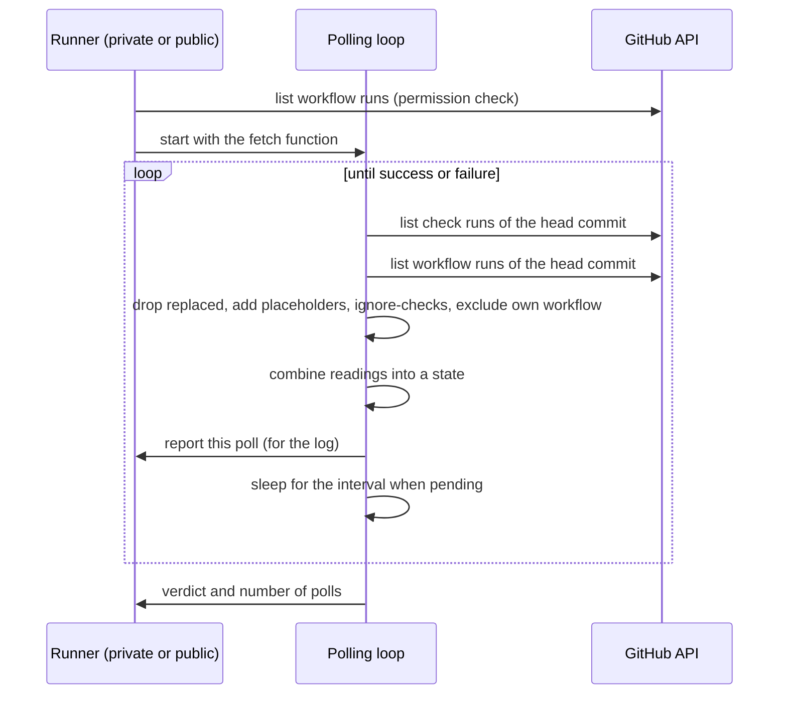

# Check aggregation design

[日本語](design.ja.md)

## About this document

This document describes how the gate meets [Check aggregation](requirements.md): what it reads from GitHub on each poll, how it narrows that to the evaluated checks, and how the polling loop ends.
The parent Product is [automerge-gate](../../product.md).

### Audience

People and agents who change what the gate reads, what it excludes, or how it polls.

### Prerequisites

GitHub's Checks API and its terms: a check run is one result on a commit, and a check suite groups the check runs one GitHub App created for one commit. Each GitHub Actions workflow run has its own check suite.

### Outside this document

When polling starts and where the verdict goes belong to [Gate modes](../gate-modes/requirements.md).
The rules of `ignore-checks` and of replaced runs are separate features whose Requirements are not yet written; this document only places them in the pipeline.

## Implementation approach

Aggregation is a loop around one function that produces the evaluated checks for the head commit.
Both gate modes build that function the same way and pass it to the same loop.
The loop asks for the evaluated checks, combines them into a state, and stops when the state is `success` or `failure`.

The parts are kept pure where possible.
Reading one check, combining the readings, deciding which runs are replaced, and matching `ignore-checks` rules take data and return data.
Only the fetch functions and the two runners touch the API and the job log, which is what lets the unit tests cover the rules without a network.

### One poll

A poll runs these steps in order.

1. **Read check runs.** One paginated request lists the check runs of the head commit, asking GitHub for the latest attempt of each. Each result keeps its name, status, conclusion, link, the slug of its GitHub App, and the id of its check suite.
2. **Read workflow runs.** One paginated request lists the workflow runs of the head commit with their workflow file, event, status, and check suite.
3. **Drop replaced results.** Workflow runs are grouped by workflow file and event; in each group every run but the newest is replaced. Check runs of replaced runs are dropped according to the replaced-run rules.
4. **Add runs without jobs.** For each workflow run that is not completed, is not replaced, has no check run yet, and is not a run of the gate's own workflow file, one placeholder check with status `queued` is added. It carries the workflow's name, the run's link, and the workflow file.
5. **Resolve workflow files.** Only when an `ignore-checks` rule uses `workflow`, each GitHub Actions check run gets the workflow file of its run.
6. **Apply `ignore-checks`.**
7. **Exclude the gate's own workflow.**

The count before step 3 is the `total-checks` output; the list after step 7 is what the loop evaluates and what `evaluated-checks` and `completed-checks` count.

### Why the placeholder exists

GitHub creates a workflow run when it queues it, but the run's jobs become check runs only a few seconds later.
A gate that polls in that gap sees every existing check run passed and would report success before the new run's jobs appear.
The case is TC-cancel-7 in the [E2E test cases](../../../../e2e-test-cases.md), where a newer run replaces a cancelled one.
The placeholder makes the queued run visible as a pending check until its real check runs exist.

### Excluding the gate's own workflow

The gate job is itself a check run on the head commit and stays `in_progress` while the gate polls, so evaluating it would never end.
Earlier gate runs on the same commit, typically cancelled by the workflow's concurrency setting, would in turn read as failures.

The gate therefore removes every GitHub Actions check run whose workflow file is the gate's own.
It learns its own workflow file from the `GITHUB_WORKFLOW_REF` environment variable, and learns a check run's workflow file by taking the run id from the check run's link and asking the Actions API for that run.
Lookups are cached per run id for the whole gate run, and a failed lookup counts as "not the gate's workflow".
When `GITHUB_WORKFLOW_REF` is missing, nothing is excluded.

Comparing workflow files, and not only the current run id, is what covers the cancelled earlier runs.

### The loop

The loop has no timeout of its own and no retry limit.
A poll that throws is treated as a failed poll: the runner has already logged a warning, and the loop sleeps for the interval and tries again.
The job's `timeout-minutes` ends a loop that never reaches a verdict.

Before entering the loop, each runner makes one request for the workflow runs.
If GitHub answers it with a client error, the runner fails the job with the message about `actions: read`.
Without this check, a missing permission would be retried as a failed poll until the job timed out.

### Why polling has no timeout input

GitHub Actions gives an action no way to read the job's `timeout-minutes`, so an action-level timeout would be a second value the user must keep below the first.
A timeout that writes `failure` reliably would also need a step that runs after the job is killed, and GitHub does not run post steps of a job it kills for timing out.
The gate therefore leaves the bound to the job and reports nothing when the job is killed.

## Architecture and sequence diagrams

## Data model and ER diagrams

Within a run, every check is held in one shape: an id, a name, a status, a conclusion that may be absent, a link, the app slug, the check suite id, and optionally the workflow file.
The workflow file has three states: not looked up, looked up and not applicable (a check from another App), and a path.
A placeholder uses the negated workflow run id as its id so that it cannot collide with a real check run.

A diagram is unnecessary; the only relationship used is check run → check suite → workflow run.

## APIs and interfaces

### Inputs

| Input | Role |
| --- | --- |
| `poll-interval-seconds` | Seconds between polls. Default `30`. Must parse as a positive integer. |
| `ignore-checks` | Rules applied in step 6. Default `[]`. |
| `token` | Token for the API. |

### Outputs

`state`, `total-checks`, `evaluated-checks`, `completed-checks`, and `polled-iterations`, as defined in the Requirements. They are set by the runner after the loop returns.

### Internal interface

The loop takes a function that returns the evaluated checks and an interval, and returns the verdict with the number of polls.
It also calls back after each poll with the poll number, the state, and the counts, which the results log uses.

## External service integration

| Purpose | Endpoint |
| --- | --- |
| Check runs of the head commit | `GET /repos/{owner}/{repo}/commits/{ref}/check-runs` with `filter=latest` ([Check runs](https://docs.github.com/en/rest/checks/runs)) |
| Workflow runs of the head commit | `GET /repos/{owner}/{repo}/actions/runs?head_sha=...` |
| Workflow file of one run | `GET /repos/{owner}/{repo}/actions/runs/{run_id}` |

Lists are requested 100 per page and followed to the end.
Each request is retried up to three times with exponential backoff, starting at 500 ms, on server errors and on errors without a status code.
Client errors are not retried.
A client error on the workflow-run list is reported as "cannot list" and turned into the `actions: read` message; a client error on the check-run list fails that poll.

Check runs could also be read per check suite, with one request to list the suites and one per suite.
The single request per commit is used so that the number of requests per poll does not grow with the number of check suites; the per-suite form runs into rate limits.

## Data handling

Everything read is kept in memory for the run and discarded. Nothing is written.

## Authentication and authorization notes

`checks: read` for check runs and `actions: read` for workflow runs and workflow files.

## Security considerations

Unknown conclusions are read as failing, so a value the gate does not know cannot turn the verdict green.
A check run without an App is treated as coming from an unknown App and is still evaluated.

## Deployment notes

None.

## Alternatives considered

### Reporting failure as soon as one check fails

The gate waits until no check is pending even when one has already failed. No record of the reason remains.

### A timeout input

Rejected for the reasons under "Why polling has no timeout input".

### Excluding only the current run by its run id

Comparing each check run's run id with the current run id is simpler.
It leaves earlier cancelled gate runs on the same commit in the evaluation, where they read as failures.

### Listing check suites and then the check runs of each suite

Its request count grows with the number of check suites, which runs into rate limits on commits with many suites.

## Open questions

- **Unconfirmed: `filter=latest` across check suites.** The replaced-run rules assume that asking for the latest attempt only collapses re-runs inside one check suite. GitHub's documentation does not say whether the per-commit request also collapses check runs with the same name in different suites. Until confirmed, the behavior is whatever GitHub returns. azu decides whether to verify it.
- **Unconfirmed: more than 1000 check suites.** GitHub documents a limit for the per-commit request when a commit has more than 1000 check suites. The gate does not handle that case. azu decides whether it matters.
