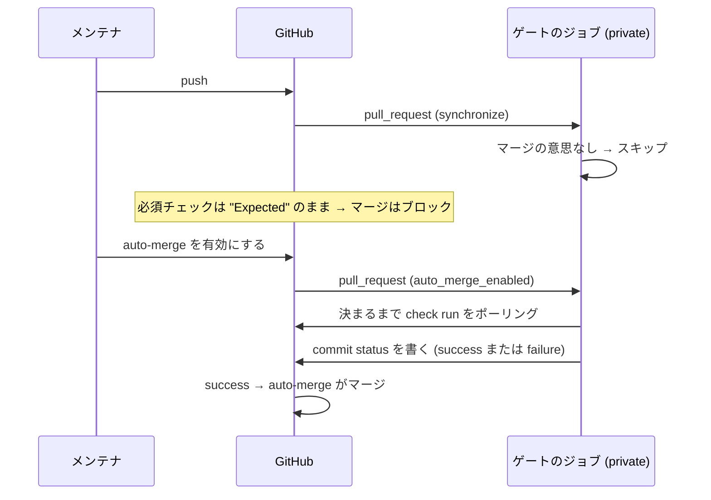
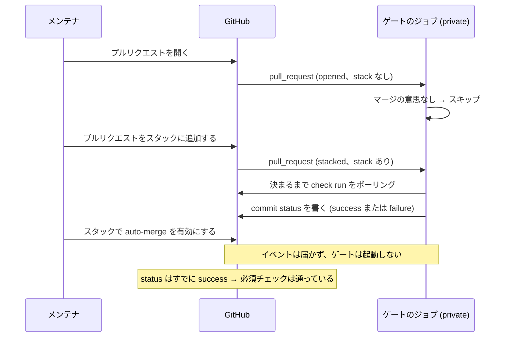
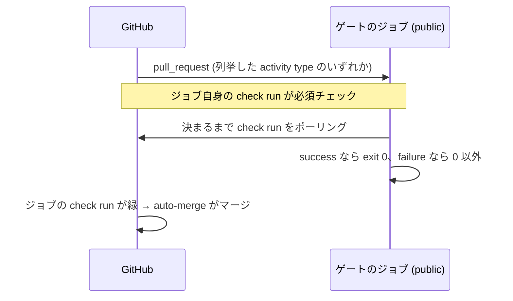

# ゲートモードの設計

[English](design.md)

## このドキュメントについて

この文書は、[ゲートモード](requirements.ja.md)の2つのモードが、いつ評価するかをどう決め、判定をどう報告するか、そしてそれぞれがその報告方法を採っている理由を説明します。
親の Product は [automerge-gate](../../product.ja.md) です。

### 対象読者

ゲートがいつポーリングするか、または判定が必須チェックへどう届くかを変更する人とエージェント。

### 前提知識

GitHub Actions のワークフローイベント、ジョブの権限、commit status と check run の違い（[About status checks](https://docs.github.com/en/articles/about-status-checks)）。

### このドキュメントで扱わないこと

check run を集めて判定までポーリングすることは、[チェックの集約](../check-aggregation/requirements.ja.md)で扱う。
ログとサマリーの出力は、[チェック結果のログ](../check-results-log/requirements.ja.md)で扱う。

## 実装方針

このアクションは、1つのジョブの1ステップとして動く、単一の JavaScript アクションである。
入口の処理は入力を解析し、イベントからプルリクエストを読み、ゲートモードごとに1つずつある2つの実行処理のどちらかに引き渡す。
イベントがプルリクエストのイベントでないときは、どちらの実行処理も始まる前に、入口の処理がジョブを失敗させる。対応外のトリガーが、成功したジョブとして終わることはない。
2つの実行処理は同じポーリングと集約を共有し、その前後で行うことだけが異なる。

private mode の実行処理は、まずポーリングするかスキップするかを決める。
判断そのものは、イベント、activity type、レビューの state、auto-merge が有効かどうか、書き込み権限のあるレビュアーの有効な Approve レビューがあるかどうか、プルリクエストがスタックの一部としてポーリングするかどうか、だけから決まる純粋な関数である。
実行処理はこれらの事実を集める。レビューの API を呼ぶのは、答えがそれに左右されるときだけである。つまり、auto-merge が無効で、スタックの一部としてポーリングするのでもない状態で新しい先頭コミットをもたらすイベントと、レビューのイベントである。
スキップのときは、出力を `skipped` と件数0に設定し、ステップサマリーを書いて終わる。そうでなければ、ポーリングし、commit status を書き、出力を設定し、判定が `failure` ならジョブを失敗させる。

public mode の実行処理には判断の段階がない。
ポーリングし、出力を設定し、判定が `failure` ならジョブを失敗させる。ジョブの結果がそのまま報告になる。

### private mode がスキップでき、public mode ができない理由

private mode では、必須チェックはゲートだけが書く commit status である。
その status がない先頭コミットは、GitHub が「Expected — Waiting for status to be reported」と表示して、すでにブロックされている。そのため、マージの意思がないイベントに対して何もしないことは安全な答えになる。

public mode では、必須チェックはゲートのジョブ自身の check run であり、ジョブは成功か失敗しかできない。
「まだ待っている」を意味する結果はなく、スキップしたジョブは必須チェックを、存在しない状態か、前の実行の緑のままにしてしまう。
そのため、ジョブはイベントごとにポーリングする。
これが、書き込みできるトークンを必要としないことの対価である。

### private mode の判定が commit status である理由

commit status は、コミットと context で識別され、どの check suite にも属さない。
API 経由で書いた check run はこれと異なる。GitHub はその check run を、GitHub 自身が選んだ check suite に付ける。プルリクエストの最初の実行の古い check suite に付くこともあり、その場合、ゲートが success を報告しているのに、必須チェックがブロックされたままになる。
commit status では、この食い違いは起こりえない。
この根拠となる観測は、[check run の状態についての記録](../../../../lessons/2026-05-06-check-run-pending-state-mapping.md)にある。

status はコミットと context で識別されるため、push のあとの後始末は要らない。新しい先頭コミットには、単にまだ status がない。
同じ理由で、ゲートは `pending` の status を書かない。status がないこと自体がすでにマージをブロックしており、書き込めば正しく保つべき書き込みが1つ増える。

### Approve レビューを API で確かめる理由

公開されたプルリクエストでは、誰でも Approve レビューを送信できる。
レビューのイベントは、レビュアーとリポジトリの関係を示すが、そこでは読み取り専用のコラボレーターとメンテナが同じ関係として示される。
そのため private mode の実行処理は、プルリクエストのレビューを一覧し、各レビュアーについてコメント以外で最新のレビューを残し、最新のレビューが Approve であるレビュアーそれぞれの権限をリポジトリに問い合わせる。
権限の結果は、その実行の間、レビュアーごとにキャッシュする。「見つからない」という答えは、書き込み権限なしとして扱う。

レビューのイベントのときだけでなく、新しい先頭コミットのたびにレビューを調べることで、Approve レビューは持続する合図になる。auto-merge が有効な間と同じように、ゲートはその後の push でもポーリングを続ける。

### スタック内のプルリクエストがマージの意思なしでポーリングする理由

`poll-on-stacked-pull-requests` は回避策であり、マージの意思の2つ目の種類ではない。
根拠は GitHub の文書にある振る舞いではなく、試行の結果である。試行の時点では、スタックの auto-merge はワークフローを起動せず、それが意図したものか一時的なものかは GitHub のドキュメントに書かれていなかった。
試行は、[スタックのプルリクエストについての記録](../../../../lessons/2026-11-17-stacked-pr-auto-merge-event.md)にある。
GitHub がスタック内のプルリクエストに `auto_merge_enabled` を届けるようになれば、private mode がふだん行うマージの意思の待ち受けがスタックでも働き、この入力は要らなくなる。

private mode はマージの意思を運ぶイベントを待つが、スタックではそのイベントが届かない。
スタックで auto-merge を有効にすると、各プルリクエストのタイムラインには記録されるが、GitHub は `auto_merge_enabled` イベントをワークフローに届けない。そのためゲートは起動せず、必須チェックは「Expected」のまま残る。

auto-merge が有効になった時点でゲートを起動するものがないので、判定はその前に先頭コミットに付いていなければならない。
そこで、`poll-on-stacked-pull-requests` が有効なとき、イベントに `stack` オブジェクトがあるプルリクエストは、新しい先頭コミットをもたらすイベントと `stacked` のたびに、public mode と同じようにポーリングする。
`stacked` が必要なのは、`opened` のイベントに `stack` オブジェクトがないためである。プルリクエストがスタックに入っていることをゲートに伝える最初のイベントが `stacked` である。
一番上のプルリクエストだけでなく、スタック内のすべてのプルリクエストがポーリングする。スタック内のプルリクエストは、それぞれが自分の先頭コミットと必須チェックを持つためである。

ゲートは自分のプルリクエストのイベントだけから判断し、API でスタックを読まない。
マージの意思なしでポーリングした理由をあとから説明できるように、スタックの番号、位置、大きさをジョブのログに書く。

受け入れた代償は2つある。
スタック内のプルリクエストには、誰もマージの意思を示していなくても `success` の status が付く。必須チェックは、誰かがマージしたがっていることを意味しなくなる。
スタック内のプルリクエストへの push のたびに、そのチェックが終わるまで runner を占有する。これは public mode と同じ費用である。
スタックを使わないリポジトリがこの2つの性質を保てるように、入力は既定で無効にしている。

## アーキテクチャ・シーケンス図

マージの意思がある private mode:

スタック内のプルリクエストで、`poll-on-stacked-pull-requests` が有効な private mode:

public mode:

## データモデル・ER 図

保存するデータはない。実行ごとにイベントと API を読み、状態はメモリ上に持つ。
永続する記録は上で述べた commit status だけなので、図は不要である。

## API・インターフェース

### 入力

| 入力 | 使うモード | 役割 |
| --- | --- | --- |
| `gate-mode` | 両方 | 実行処理を選ぶ。必須。 |
| `context` | private | commit status の context。既定は `automerge-gate/all-passed`。 |
| `poll-on-stacked-pull-requests` | private | `true` にすると、スタック内のプルリクエストがマージの意思なしでポーリングする。既定は `false`。`true` と `false` だけを受け付ける。 |
| `token` | 両方 | すべての API 呼び出しに使うトークン。既定はワークフローのトークン。空であってはならない。 |

### ワークフローファイル

どのイベントがアクションに届くかを決めるため、ワークフローファイルもインターフェースの一部である。

private mode では、ワークフローは `pull_request` の `opened`、`synchronize`、`reopened`、`auto_merge_enabled` と、`pull_request_review` の `submitted` を受ける。
`poll-on-stacked-pull-requests` が有効なときは、`pull_request` の activity type に `stacked` も挙げる。
ジョブ単位の条件で、Approve のレビューだけがジョブを起動するようにする。コメントのレビューで runner が起動しないようにするためである。GitHub のトリガーの絞り込みでは、レビューの state を選べない。
concurrency のグループは、ワークフローではなくジョブに設定する。その条件で除かれたレビューのイベントがグループに入らず、ポーリング中のジョブをキャンセルできないようにするためである。

public mode では、ワークフローは同じ `pull_request` の activity type を受け、ジョブの `name:` を必須チェックと同じにし、concurrency のグループをワークフロー単位に置く。

どちらも、ワークフロー名とプルリクエストの ref を concurrency のグループにし、`cancel-in-progress: true` を付ける。同じプルリクエストでは、新しいイベントが古いポーリング中のジョブを置き換える。

### commit status

private mode の実行処理は、state、context、140文字以内の説明文、ゲートのワークフロー実行の現在の試行へのリンクを付けて status を書く。
このリンクは、status をクリックしたメンテナが、実行を再実行できるページに着くようにするためのものである。

## 外部サービスとの連携方式

すべての呼び出しは、`token` 入力を使って GitHub の REST API に対して行う。

| 目的 | エンドポイント | モード |
| --- | --- | --- |
| プルリクエストのレビューの一覧 | `GET /repos/{owner}/{repo}/pulls/{number}/reviews` | private |
| レビュアーの権限の取得 | `GET /repos/{owner}/{repo}/collaborators/{username}/permission` | private |
| 判定の書き込み | `POST /repos/{owner}/{repo}/statuses/{sha}`（[Commit statuses](https://docs.github.com/en/rest/commits/statuses)） | private |

それぞれの呼び出しは、サーバーエラーと、ステータスコードのないエラーに対して、間隔を倍々に延ばしながら3回まで再試行する。クライアントエラーは再試行せず、ジョブを失敗させる。ただし、レビュアーの権限に対する「見つからない」という答えは除く。

## データの取り扱い設計

プルリクエスト、そのレビュー、レビュアーの権限は、判断のために読み、実行が終わると捨てる。
レビュアーのログイン名、最新のレビューの state、権限の水準は、スキップやポーリングの理由をあとから説明できるように、ジョブのログに出す。

## 認証認可に関する特記事項

private mode は、status を書くための `statuses: write`、レビューを一覧するための `pull-requests: read`、集約のための `checks: read` と `actions: read` を必要とする。
public mode は読み取りの権限だけを必要とする。
ゲートは、誰が auto-merge を有効にしたかを確かめない。GitHub は、マージできるユーザーにだけ有効化を許す。

## セキュリティ上の留意事項

Approve レビューでポーリングを始める前に、Approve したレビュアー全員について、権限のエンドポイントで書き込み権限を確かめる。
public mode は書き込みの権限を持たないため、fork からのプルリクエストが操作できるものによって、ゲートにリポジトリへ書き込ませることはできない。

## デプロイに関する特記事項

なし。リリースは書き換えられないタグであり、利用者がワークフローファイルで固定する。

## 検討した代替手段

### `check_suite.completed` や `check_run.completed` から起動する

これらのイベントを使えば、チェックが終わったときに一度だけ、ポーリングなしでゲートを動かせる。
しかし GitHub Actions は、GitHub Actions が作った check suite と check run ではワークフローを起動しない。そのため、GitHub Actions だけを使うリポジトリではゲートが動かない。
この観測は、[check suite の再帰についての記録](../../../../lessons/2026-05-05-check-suite-recursion-finding.md)にある。

### `workflow_run` から起動する

利用者がワークフロー名を列挙する必要があり、新しいワークフローには追従できず、外部の App のチェックは対象にならない。

### `status` から起動する

以前からある commit status にしか反応しない。また、commit status を書くゲートが自分自身をもう一度起動するおそれがある。

### private mode で push のたびにポーリングする

merge-gatekeeper の方式である。誰かがマージするつもりかどうかに関係なく、push のたびに、そのチェックが終わるまで runner を占有する。マージの意思を待つことによる費用の利点がなくなる。

### プルリクエストを開いたときに `pending` の status を書く

push のたびとポーリングの前に pending の結果を書けば、必須チェックが最初から「auto-merge 待ち」と表示され、ゲートのポーリング中は進行が見える。
設計を単純に保つために、これは行わない。書き込みは実行ごとに1回だけにし、正しく保つべき2つ目の書き込みを作らない。
受け入れた代償は、ポーリング中のプルリクエストには GitHub の「Expected」の行だけが表示され、ゲートが動いていることを確かめるにはワークフロー実行を開く必要があることである。
試した結果は、[check run の状態についての記録](../../../../lessons/2026-05-06-check-run-pending-state-mapping.md)にある。

### private mode の判定を check run として報告する

check run には Markdown と詳細へのリンクを持たせられるが、どの check suite に付くかは GitHub が決める。それが上で述べた食い違いの原因になった。

### スタック内のプルリクエストの、あとから届くイベントで auto-merge を読む

スタックで auto-merge が有効になったあとに届くイベントには auto-merge の状態が入っているので、ゲートはマージの意思を待ち続け、次の push でそれを拾うこともできる。
これは行わない。auto-merge が有効になった時点ではイベントが届かないので、そのあと push されないスタックは評価されないままになる。
また試行では、状態が入るのはスタックの一番上のプルリクエストだけだった。下のプルリクエストでは、別のプルリクエストの状態が必要になる。

### スタックを使うリポジトリで public mode を使う

public mode はもともとイベントごとにポーリングするので、新しい入力がなくてもスタックに判定が付く。
これを必須にはしない。スタックに入っていないものを含めて、リポジトリのすべてのプルリクエストが push のたびにポーリングすることになるためである。

### `pull_request_target` で fork からのプルリクエストに対応する

あとで検討する案として挙げられていた以外に、評価の記録は残っていない。public mode は、書き込みできるトークンなしで fork からのプルリクエストに対応している。

## 未決事項

[Requirements](requirements.ja.md#未決事項) にあるもの以外は、なし。
