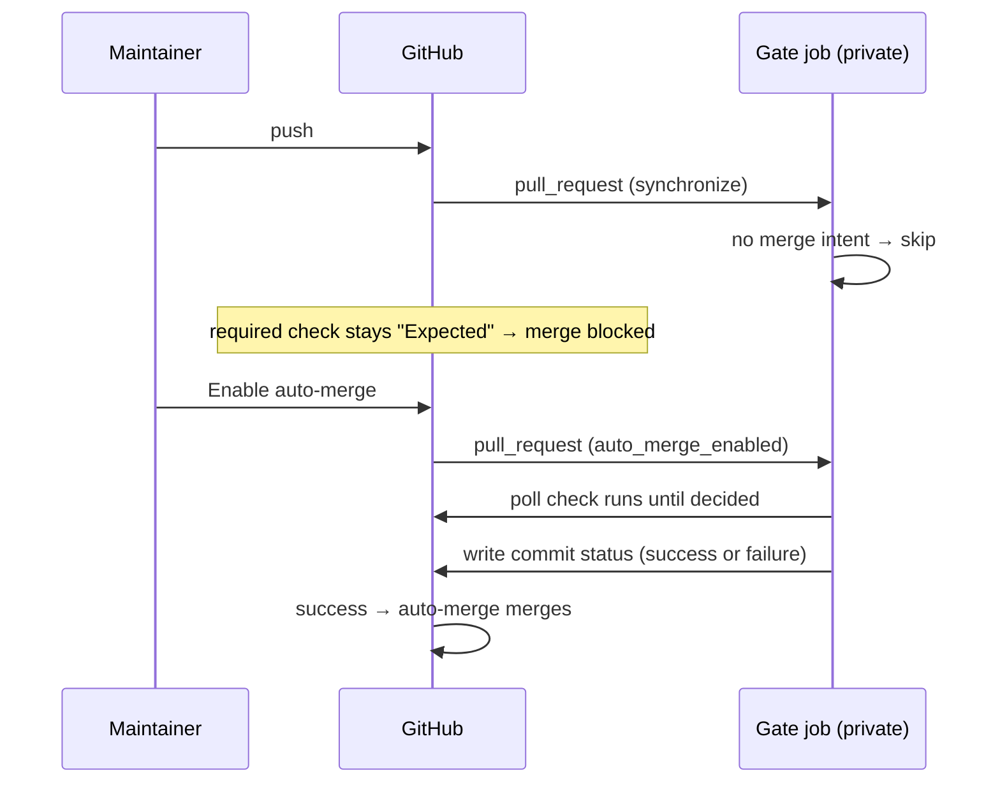
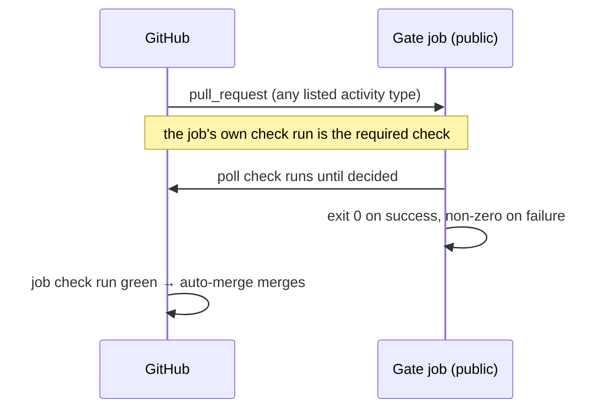

# Gate modes design

[日本語](design.ja.md)

## About this document

This document describes how the two gate modes in [Gate modes](requirements.md) decide when to evaluate and how they report the verdict, and why each mode reports it the way it does.
The parent Product is [automerge-gate](../../product.md).

### Audience

People and agents who change when the gate polls or how the verdict reaches the required check.

### Prerequisites

GitHub Actions workflow events, job permissions, and the difference between commit statuses and check runs ([About status checks](https://docs.github.com/en/articles/about-status-checks)).

### Outside this document

Collecting check runs and polling them to a verdict belong to [Check aggregation](../check-aggregation/requirements.md).
Log and summary output belongs to [Check results log](../check-results-log/requirements.md).

## Implementation approach

The action is a single JavaScript action that runs as one step of one job.
Its entry point parses the inputs, reads the pull request from the event, and hands over to one of two runners, one per gate mode.
When the event is not a pull request event, the entry point fails the job before either runner starts, so an unsupported trigger cannot end as a successful job.
Both runners share the same polling and aggregation and differ only in what happens before and after it.

The private runner first decides between polling and skipping.
The decision itself is a pure function of the event, the activity type, the review state, whether auto-merge is enabled, and whether an active Approve review from a reviewer with write access exists.
The runner gathers those facts, calling the reviews API only when the answer depends on it: on an event that brings a new head commit while auto-merge is off, and on a review event.
A skip sets the outputs to `skipped` with zero counts, writes the step summary, and returns. Otherwise the runner polls, writes the commit status, sets the outputs, and fails the job when the verdict is `failure`.

The public runner has no decision step.
It polls, sets the outputs, and fails the job when the verdict is `failure`; the job's result is the report.

### Why private mode can skip and public mode cannot

In private mode the required check is a commit status that only the gate writes.
A head commit without that status is already blocked, shown by GitHub as "Expected — Waiting for status to be reported", so doing nothing is a safe answer to an event without merge intent.

In public mode the required check is the gate job's own check run, and a job can only succeed or fail.
There is no result that means "still waiting", and a skipped job would leave the required check either missing or green from an earlier run.
The job therefore polls on every event.
This is the price of not needing a write token.

### Why the verdict is a commit status in private mode

A commit status is identified by the commit and its context and belongs to no check suite.
A check run written through the API is different: GitHub attaches it to a check suite of its own choosing, sometimes a stale one from the pull request's first run, and the required check then stays blocked although the gate reported success.
With a commit status that mismatch cannot happen.
The observation behind this is recorded in [the check run state notes](../../../../lessons/2026-05-06-check-run-pending-state-mapping.md).

Because the status is keyed by commit and context, a push needs no cleanup: the new head commit simply has no status yet.
For the same reason the gate writes no `pending` status. An absent status already blocks merging, and writing one would add a second write to keep correct.

### Why an Approve review is checked through the API

Anyone can submit an Approve review on a public pull request.
The review event says how the reviewer relates to the repository, but a read-only collaborator and a maintainer have the same relationship there.
The private runner therefore lists the pull request's reviews, keeps each reviewer's latest review that is not a comment, and asks the repository for the permission of each reviewer whose latest review is an Approve.
Permission results are cached per reviewer within the run, and a "not found" answer counts as no write access.

Looking up reviews on each new head commit, and not only on the review event, is what makes an Approve review a lasting signal: the gate keeps polling on later pushes, the same way it does while auto-merge is enabled.

## Architecture and sequence diagrams

Private mode with merge intent:

Public mode:

## Data model and ER diagrams

No stored data. Each run reads the event and the API and keeps its state in memory.
A diagram is unnecessary because the only persistent record is the commit status described above.

## APIs and interfaces

### Inputs

| Input | Used by | Role |
| --- | --- | --- |
| `gate-mode` | Both | Selects the runner. Required. |
| `context` | Private | Context of the commit status. Default `automerge-gate/all-passed`. |
| `token` | Both | Token for every API call. Default is the workflow's token. Must not be empty. |

### Workflow file

The workflow file is part of the interface, because it decides which events reach the action.

In private mode the workflow listens to `pull_request` with `opened`, `synchronize`, `reopened`, and `auto_merge_enabled`, and to `pull_request_review` with `submitted`.
A job-level condition lets only approved reviews start the job, so that comment reviews do not start a runner; GitHub's trigger filters cannot select by review state.
The concurrency group is set on the job, not on the workflow, so a review event filtered out by that condition never joins the group and cannot cancel a polling job.

In public mode the workflow listens to the same `pull_request` activity types, sets the job's `name:` to the required check, and puts the concurrency group at the workflow level.

Both use the workflow name and the pull request's ref as the concurrency group with `cancel-in-progress: true`, so a newer event replaces an older polling job for the same pull request.

### Commit status

The private runner writes the status with the state, the context, a description of at most 140 characters, and a link to the current attempt of the gate's workflow run.
The link exists so that a maintainer who clicks the status lands on the page where the run can be re-run.

## External service integration

All calls go to the GitHub REST API with the `token` input.

| Purpose | Endpoint | Mode |
| --- | --- | --- |
| List reviews of the pull request | `GET /repos/{owner}/{repo}/pulls/{number}/reviews` | Private |
| Read a reviewer's permission | `GET /repos/{owner}/{repo}/collaborators/{username}/permission` | Private |
| Write the verdict | `POST /repos/{owner}/{repo}/statuses/{sha}` ([Commit statuses](https://docs.github.com/en/rest/commits/statuses)) | Private |

Each call is retried up to three times with exponential backoff on server errors and on errors without a status code. Client errors are not retried and fail the job, except the "not found" answer for a reviewer's permission.

## Data handling

The pull request, its reviews, and reviewer permissions are read for the decision and discarded when the run ends.
Reviewer logins, their latest review states, and their permission levels are written to the job log so that a skip or a poll can be explained afterwards.

## Authentication and authorization notes

Private mode needs `statuses: write` to write the status, `pull-requests: read` to list reviews, and `checks: read` and `actions: read` for aggregation.
Public mode needs only the read permissions.
The gate does not check who enabled auto-merge; GitHub only lets users who can merge enable it.

## Security considerations

Write access is verified through the permission endpoint for every approving reviewer before an Approve review starts polling.
Public mode holds no write permission, so nothing a fork pull request controls can make the gate write to the repository.

## Deployment notes

None. A release is an immutable tag that users pin in their workflow file.

## Alternatives considered

### Starting from `check_suite.completed` or `check_run.completed`

These events would let the gate run once when checks finish, without polling.
GitHub Actions does not start workflows for check suites and check runs that GitHub Actions created, so in a repository that uses only GitHub Actions the gate never runs.
The observation is recorded in [the check suite recursion notes](../../../../lessons/2026-05-05-check-suite-recursion-finding.md).

### Starting from `workflow_run`

The user would have to list workflow names, new workflows would not be followed, and checks from external Apps would not be covered.

### Starting from `status`

It reacts only to legacy commit statuses, and a gate that writes a commit status could start itself again.

### Polling on every push in private mode

This is what merge-gatekeeper does. Every push holds a runner until its checks finish, whether or not anyone intends to merge, which removes the cost advantage of waiting for merge intent.

### Writing a `pending` status when a pull request opens

Writing a pending result on every push and before polling would make the required check show "awaiting auto-merge" from the start and show progress while the gate polls.
It is not done, to keep the design simple: one write per run, and no second write to keep correct.
The accepted cost is that during polling the pull request shows only GitHub's "Expected" line, so a maintainer has to open the workflow run to see that the gate is running.
The trials are recorded in [the check run state notes](../../../../lessons/2026-05-06-check-run-pending-state-mapping.md).

### Reporting the private-mode verdict as a check run

A check run can carry Markdown and a details link, but GitHub chooses its check suite, which caused the mismatch described above.

### Supporting fork pull requests through `pull_request_target`

No record of an evaluation remains beyond its listing as a later idea. Public mode covers fork pull requests without a write token.

## Open questions

None.
